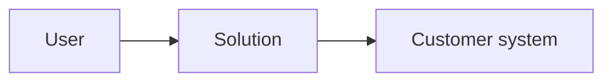

# Design: <solution name>

## Context

<The problem and goals, from the constraints; what exists today; what this design changes.>

## Diagram

## Integrations

| System | Direction | Interface | Owner on the customer side |
|---|---|---|---|
| <system> | <in, out or both> | <API, file, queue> | <role> |

## Security

<Authentication, authorization, data boundaries and approved AI providers from the constraints; how each is met.>

## Rollout

| Stage | What goes live | How it is checked | How it is rolled back |
|---|---|---|---|
| <stage> | <scope> | <test or evidence> | <rollback step> |

## Secrets

Names and locations only: never a value.

| Secret | Where it lives | Who can read it |
|---|---|---|
| <name> | <vault, keychain or service, by name> | <role> |
