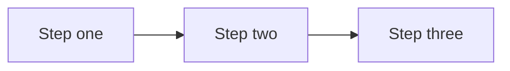
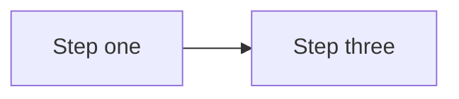

# Workflow: <process name>

## Current process

| Step | Who | What | Tool | Pain point |
|---|---|---|---|---|
| <step> | <role> | <action> | <tool> | <what goes wrong or is slow> |

## Future process

| Step | Who | What | Tool | Change |
|---|---|---|---|---|
| <step> | <role or agent> | <action> | <tool> | <same, changed, automated or removed> |
